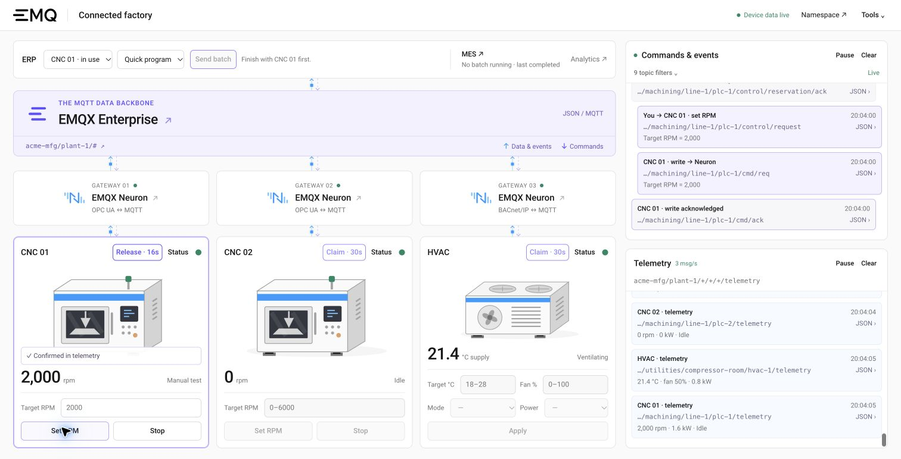
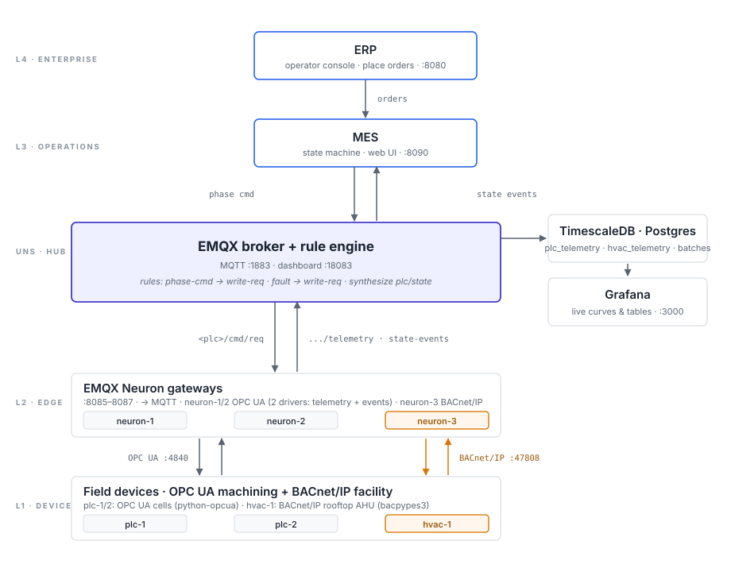

# ERP ↔ MES ↔ PLC Demo

Batch process integration over MQTT (ERP ↔ MES ↔ PLC), built on EMQX and
EMQX Neuron.

The shop-floor scenario is a CNC machining cell — two PLCs running a
multi-phase part program (`load → rough → finish → unload`) and streaming
generic CNC telemetry (spindle RPM, feed rate, coolant temperature, torque,
power). Alongside them, a third neuron talks **BACnet/IP** to a simulated
facility HVAC unit, showing the same Neuron + EMQX stack ingesting both
shop-floor OPC UA and brownfield building-automation BACnet side-by-side.



## Live demo

Open <http://localhost:8080> for the live shop-floor-to-cloud overview:
individual CNC and HVAC devices, their Neuron gateways, the EMQX namespace,
and enterprise applications. Data flows upward; MES commands return to the
addressed CNC. The enterprise/cloud tier represents the application layer;
all services in the local demo run in Docker. Equipment is simulated;
protocol acquisition, MQTT distribution, MES commands and state changes use
the running stack. Device controls, per-device claim queues, an ERP batch
button and two live MQTT traffic panes are on the same page, also at
`/showcase`. **Tools** opens the individual applications.
All published service ports bind to `127.0.0.1` for local access.

## Layout

<details>
<summary>Architecture diagram</summary>



The same diagram is available on the [demo tools page](http://localhost:8080/tools).

</details>

```
docker-compose.yml             EMQX + 2 PLCs + 1 HVAC + 3 neurons + MES + operator + storage
services/operator/             Flask: ERP "place order" panel + PLC/order status
services/mes-sim/              Python: state-machine MES, web UI for batches in flight
services/plc-sim/              Python: OPC UA machining-cell PLC, command-driven
services/hvac-sim/             Python: BACnet/IP rooftop AHU simulator (bacpypes3)
emqx/base.hocon                rule engine + Timescale sinks (plc + hvac)
timescale/init.sql             plc_telemetry + hvac_telemetry hypertables + batches table
grafana/                       provisioned datasource + production-overview + facility-hvac dashboards
tools/provision_neuron.py      REST-API neuron provisioning (OPC UA on neuron-1/2, BACnet on neuron-3)
tools/place_order.py           dev helper: publish a JSON order from the CLI
```

## Quick start

Install Docker with Docker Compose and [uv](https://docs.astral.sh/uv/)
for the provisioning and command-line helpers. Run these commands from the
repository root:

```bash
make up           # generate private local credentials, then build/start
# wait ~30s for the neurons to finish first-boot init
make provision    # configure Neuron, viewers, database grants and retention
```

Open <http://localhost:8080> and wait for **All sources live**: both CNCs
and the HVAC unit must have fresh telemetry. Each browser gets its own
signed visitor session; each device has its own claim queue.
`make help` lists the available targets.

App images are pinned to EMQX 6.3.2, NeuronEX 4.0.0, Grafana 13.2.2, and
TimescaleDB 2.30.1 on PostgreSQL 17.

Open:

- **Live showcase** — <http://localhost:8080/showcase> (device controls, ERP orders and MQTT traffic)
- **Demo home** — <http://localhost:8080> (live device-to-cloud map and interactive controls)
- **Demo tools** — <http://localhost:8080/tools> (architecture reference and product links)
- **Operator console** — <http://localhost:8080/console> (redirects to the interactive home)
- **MES** — <http://localhost:8090> (read-only batch execution view)
- **Grafana** — <http://localhost:3000/d/production-overview> (machining) / <http://localhost:3000/d/facility-hvac> (HVAC)
- **EMQX dashboard** — <http://localhost:18083> (viewer / demo-viewer)
- **Neuron UI** — neuron-1 OPC UA <http://localhost:8085>, neuron-2 OPC UA <http://localhost:8086>, neuron-3 BACnet/IP <http://localhost:8087> (viewer / demo-viewer)

Administrator passwords and service credentials are generated once in the
gitignored `.env` file. `make security-init` preserves existing secrets.
The public Viewer password is deliberately shareable and grants no writes.
Grafana uses anonymous Viewer access with a dedicated database role that
can only SELECT from the three demo history tables.

### Testing with separate browsers

1. Open the home page in two browsers, or a regular window and a private
   window. Tabs in the same browser profile share one visitor session.
2. In browser A, **Claim · 30s** on CNC 01, then **Set RPM**. Watch the
   `cmd/req`, gateway `cmd/ack`, and changed spindle reading. The spindle
   setting is bounded to 0–6,000 rpm and only applies outside MES batches.
3. In browser B, **Join queue** on CNC 01. Its controls remain disabled
   until A releases or expires, the defaults are restored, and B reaches
   the front of the queue. B can instead claim HVAC or CNC 02 independently.
4. Claim HVAC to change temperature (18–28 °C), fan speed (0–100%), mode
   and enable state. Commands travel through Neuron over BACnet/IP.
5. Use **Send batch** on ERP to queue one part on the selected CNC.
   MES first acknowledges the reservation, then runs the selected recipe.
   The submitting browser can Hold, Resume, inject/clear a fault or End batch
   from that CNC's card. Other browsers cannot change its settings.
6. Sign into EMQX and Neuron with `viewer / demo-viewer`: reads work, writes
   are rejected. Direct MES API writes and browser MQTT publishing are denied.

Each device allows one active reservation and at most three waiting requests.
Each browser may have only one active or waiting request across all devices.
Manual claims last 30 seconds; abandoned manual claims and waiting requests
expire after 20 seconds without polling. ERP reservations last through batch
completion, with a 90-second cap. A batch continues if its browser closes.
Expired, released or restarted claims restore device defaults before handoff;
CNC spindle deadlines are also enforced locally by the PLC simulator.

Anonymous sessions have admission limits of 6 requests/minute per browser,
15/minute per IP and 40/minute globally. Writes are limited to 8 per 5 seconds
per visitor and one unconfirmed setting change per device. Status snapshots
need no claim, but are limited to 6 per 10 seconds per visitor and 90/minute
globally. Full queues and rate limits return HTTP 429 with `Retry-After`.

HTTP controls require a CSRF token; writes also require the owner's unexpired
lease. Batch controls validate the current batch and phase. Retried queue
submission IDs do not create another request. Cookie limits are not proof of
unique human identity: clearing cookies or changing browsers creates another
visitor, with IP and global limits still applying.

Browser MQTT connections use five-minute RS256 JWTs bound to client ID and
username. Only the operator holds the private signing key. Broker ACLs allow
subscriptions to demo telemetry, commands and events; publishing and gateway
file-management topics are denied. Internal services use separate credentials
and topic ACLs. The namespace tree and traffic panes are real MQTT subscribers.

## Operating the demo

### Commands and live traffic

There is no walkthrough to start. Use the controls on device cards, or the
ERP button for a complete `program-a` or `program-quick` batch. The quick
program skips finish machining. An ERP order joins the selected CNC's queue
and holds that device until the order ends. MES cannot allocate a machine
that has a manual claim, and manual settings cannot alter a reserved batch.

The right side has two independent displays:

- **Commands & events**: orders, reservations, device writes, gateway
  acknowledgements, lifecycle events and batch records. The last 100 messages
  are kept; unchanged reservation heartbeats and duplicate retained states
  on reconnect are suppressed. Rows name the device and summarize writes.
- **Telemetry**: bundled readings, displayed at most once per device per
  second, with a 60-message history and the actual incoming message rate.

Each pane lists its actual MQTT subscription filters and has Pause/Clear.
Use each row's **JSON ›** disclosure to inspect its full topic and payload.
Pausing freezes that display and shows **Paused**; it does not pause devices.
Retained messages say **retained · on connect**, rather than showing a new event
time. A successful gateway
acknowledgement means the write was accepted; the card reports success only
after the requested values appear in fresh telemetry.

**Status** publishes a request and a response containing the latest observed
telemetry, with its timestamp and freshness. It is explicitly a cached status
snapshot, not a fresh on-demand OPC UA or BACnet read.
The reply appears on the device, including when its MQTT viewer is paused or
active in another tab. Settings are labelled as targets and show ranges until
claimed; measured values remain separate. Queue badges appear only when relevant.

**Device data live** describes backend device monitoring. Each MQTT pane separately
shows its browser subscription state. The existing one-viewer-per-browser/view
limit also applies across tabs: a displaced viewer shows **Other tab** and
**Watch here** moves the feed back, without reconnect loops or broader permissions.

Blue paths carry telemetry/events; purple paths carry orders/commands. Highlighted
paths reflect recently observed MQTT messages, not exact network transit times. The
larger device dots show telemetry freshness; claim buttons show control ownership
and the remaining turn time. An idle
machine can have fresh readings; a connected broker alone does not prove that
a device is healthy. HVAC remains outside the MES production allocation pool.

### Release and recovery

**Release** ends your manual claim. **End batch** cancels your own ERP order
through MQTT → MES → Neuron → OPC UA. Both wait for confirmed device recovery
before the next visitor receives control. CNC defaults are spindle stopped;
HVAC defaults are 22 °C, 50% fan, Auto mode and Enabled. History is preserved.

Claims persist in SQLite. After an operator restart, active claims recover
before accepting further writes; waiting requests are cancelled. If a gateway
is offline, recovery waits for its write acknowledgement and fresh default
values. Restore connectivity to resume that device's queue.

The private local `make booth-reset` helper recovers active claims. The older
`make booth-loop` diagnostic is operator-only and cannot start while claims
are active or queued; it has no public UI. `make place-order` is a privileged
CLI diagnostic that bypasses the browser queue but still respects device
reservations and bounded MES admission.

| Symptom | What to check |
| --- | --- |
| Source data stays stale | Run `docker compose ps`, then `make provision`. Inspect the relevant Neuron driver and tags. |
| Device says Restoring defaults | Restore its gateway/MQTT connection; handoff waits for acknowledgement and fresh baseline values. |
| MQTT pane is disconnected | Check the WebSocket listener at `ws://localhost:8083/mqtt`. The browser renews its read-only token automatically. |
| Controls are disabled | Check the device's claim/queue label; only its current owner may write, and batches reserve their CNC. |

Useful diagnostics:

```bash
docker compose ps
docker compose logs --tail=100 operator mes plc-1 plc-2 hvac-1
curl -i http://localhost:8080/readyz
```

`/readyz` returns 200 only when MQTT and all three device sources are fresh;
`/healthz` checks the operator HTTP service only.

## Configuration

Set `SHOWCASE_TITLE` and `SHOWCASE_EVENT` in `.env` to customize the title.
Compose accepts `ENTERPRISE`, `SITE` and `LINE` for the topic namespace.
The security initializer and provisioners also read `.env`; shell values take
precedence. Keep machining/utilities areas consistent with the broker rules.
The provisioner accepts `NEURON_API_1` through `NEURON_API_3` for alternative
Neuron endpoints and `BACNET_HOST` for the HVAC device's numeric IP.

`CLAIM_SECONDS` (30), `BATCH_SECONDS` (90) and `DEVICE_QUEUE_SIZE` (3) can be
set in `.env`, then applied with `make up`. Keep manual claims at or below
60 seconds to match the PLC's independent deadline guard. Run one operator
process: the supplied server uses one scheduler and eight HTTP threads.

MES has two fixed workers and a three-order backlog, validates order expiry,
persists deduplication, and aborts orphaned batches after restart. Batch IDs
are UUIDs; in-memory batch history is capped at 100. Retained messages expire
after a day, telemetry after seven days and database batch records after 30 days.

The optional hosted profile uses Caddy and the same restrictions. Create
`.env.booth` with `uv run tools/booth_credentials.py factory.example.com`,
configure the domain and product subdomains, then `make booth-up`. It requires
HTTPS cookies and adds a shared entrance password. Local testing needs neither
a domain nor HTTPS. The hosted profile has not been deployed by this change.

## Checking the demo

```bash
make check               # ownership, limits, expiry, recovery and MES allocation
make check-ui            # UI state/connection regressions; Node 18+ (no npm dependencies)
make check-restrictions  # running, provisioned stack; start with no active claims
```

The live check uses six independent cookie jars, actual MQTT connections,
product APIs and a database connection. It checks forbidden writes, queue
capacity, copied leases, real OPC UA/BACnet setting changes, default recovery,
FIFO handoff, manual expiry and a complete ERP batch on a different CNC.
It restores its own devices afterward. For manual verification, repeat the
browser steps above and inspect the MQTT request/acknowledgement/value chain.

## Topics

```
acme-mfg/<site>/orders/<id>                                              # ERP → MES
acme-mfg/<site>/orders/<id>/status                                       # MES → ERP (retained)
acme-mfg/<site>/machining/<line>/<plc>/state                             # PLC (retained, synthesized)
acme-mfg/<site>/machining/<line>/<plc>/telemetry                         # PLC via Neuron (OPC UA)
acme-mfg/<site>/machining/<line>/<plc>/state-events                      # PLC transitions via Neuron
acme-mfg/<site>/machining/<line>/<plc>/batch/<bid>/phase/<p>/command     # MES → PLC
acme-mfg/<site>/batches/<bid>/record                                     # MES (retained)
acme-mfg/<site>/utilities/compressor-room/hvac-1/telemetry               # HVAC via Neuron (BACnet/IP)
acme-mfg/<site>/<area>/<line>/<device>/cmd/req                           # Scoped Neuron write
acme-mfg/<site>/<area>/<line>/<device>/cmd/ack                           # Gateway acknowledgement
acme-mfg/<site>/<area>/<line>/<device>/control/request                   # Visitor command / status request
acme-mfg/<site>/<area>/<line>/<device>/control/response                  # Observed status snapshot
acme-mfg/<site>/machining/<line>/<plc>/control/reservation               # Retained MES reservation
acme-mfg/<site>/machining/<line>/<plc>/control/reservation/ack           # MES reservation acknowledgement
```

Defaults: `ENTERPRISE=acme-mfg`, `SITE=plant-1`, `LINE=line-1`.
The CNC area is fixed to `machining` in Compose and provisioning to match
the broker rules. HVAC uses `utilities/compressor-room`.

## Upgrading an existing installation

Neuron 4.0.0 uses fresh `neuron-1-v4-data`, `neuron-2-v4-data` and
`neuron-3-v4-data` volumes. Existing 3.x volumes are left intact; `make provision`
recreates this demo's drivers and tags in 4.0. Any extra manually configured
drivers or licenses must be exported/backed up separately before migration.
[Automatic migration from 3.x starts with 4.0.1](https://docs.emqx.com/en/neuronex/latest/installation/upgrade-4.0.html),
so this repository does not mount a legacy volume into the requested 4.0.0 image.

Neuron 4.0.0 also subscribes to the legacy `neuron/uns-mqtt/read/req`
topic even with a configured driver topic prefix. The gateway ACLs allow
this subscription; visitor and application identities cannot publish there.
Demo writes continue through the scoped `.../<device>/cmd/req` topics.

Back up the database and `grafana-data` volume first. [Grafana 13 migrates
dashboard storage](https://grafana.com/docs/grafana/latest/upgrade-guide/upgrade-v13.0/),
so rolling back requires restoring the backup. PostgreSQL stays on major
version 17 to preserve data-volume compatibility.

```bash
make security-init
docker compose pull
docker compose build --pull
docker compose up -d
docker compose exec timescaledb psql -X -U demo -d demo -v ON_ERROR_STOP=1 \
  -c 'ALTER EXTENSION timescaledb UPDATE;'
make provision
```

The extension update is required for an existing TimescaleDB database;
fresh volumes install the current extension automatically.

## Stopping or rebuilding from scratch

`make down` stops the services and preserves their named volumes. Use
`make up` to start them again.

For a fresh installation, the following commands **delete all demo volumes**,
including database history, Grafana state and Neuron configuration, then
recreate and provision the stack. Use **Release** or **End batch** for ordinary
repeated demonstrations.

```bash
make reset
make provision
```
